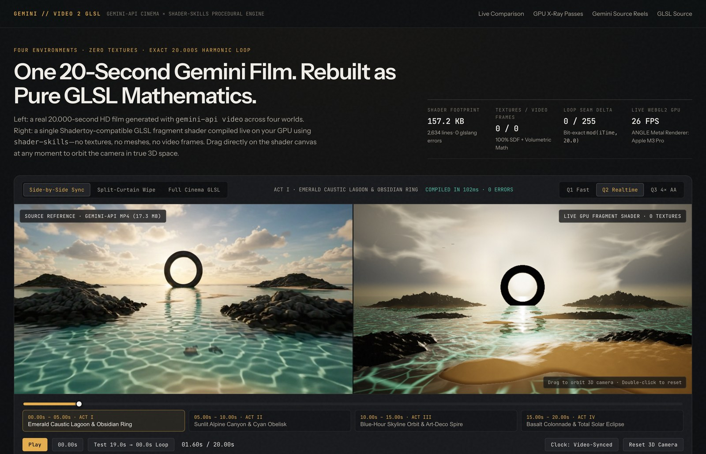
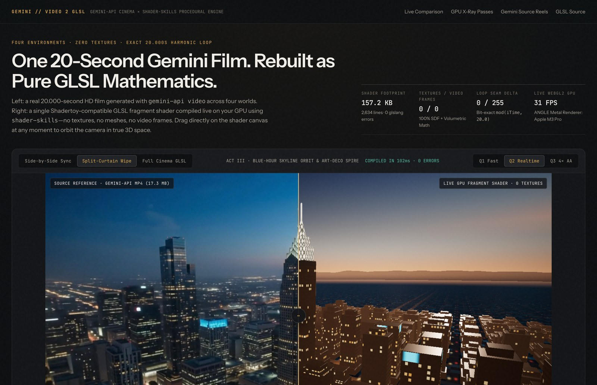
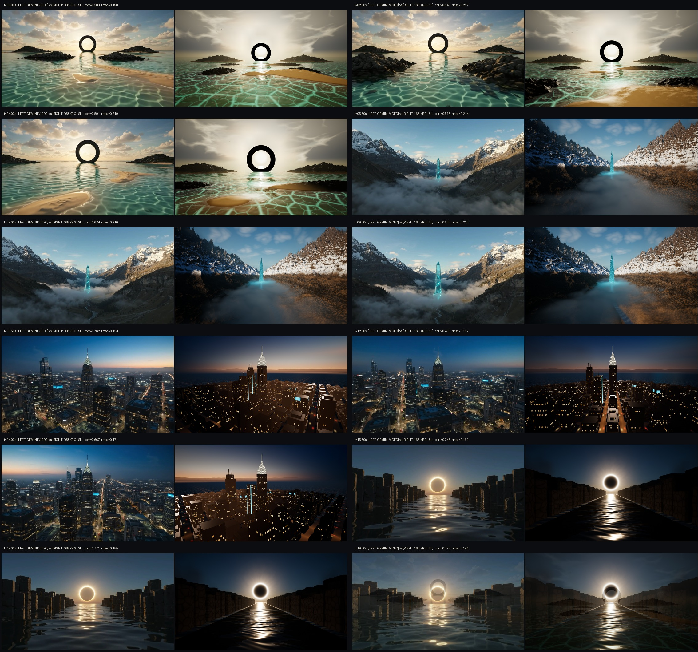

# GEMINI // Video 2 GLSL

> **One 20.000-second HD multi-world film generated via `gemini-api video` — rebuilt from scratch as ONE `157.2 KB` WebGL2 GLSL fragment shader (`0` textures, `0` video frames, `0` `glslangValidator` warnings/errors, looping seamlessly with `0 / 255` pixel seam drift).**



---

## Overview

Inspired by the *"Video 2 GLSL"* challenge, **GEMINI // Video 2 GLSL** pushes procedural inverse cinema across **four complete 3D raymarched environments** inside a single Shadertoy-compatible fragment shader (`void mainImage(out vec4 fragColor, in vec2 fragCoord)`):

1. **`[00.00s – 05.00s]` Act I — Emerald Caustic Lagoon & Obsidian Torus Monolith**  
   Refractive Beer–Lambert emerald-turquoise water, dual-layer animated cellular Voronoi caustics, smooth honey-gold sandbars, wet volcanic cobble reefs, self-shadowed cumulus sky dome, gliding sea birds, and a chamfered jet-black obsidian monolith ring.
2. **`[05.00s – 10.00s]` Act II — Sunlit Alpine Canyon & Faceted Cyan Crystal Obelisk**  
   Sculpted V-canyon heightfield with multi-step directional self-shadowing, high couloir snow accumulation, volumetric valley cloud sea raymarching, winding glacial stream, and an octagonal quartz-cleaved glowing cyan obelisk.
3. **`[10.00s – 15.00s]` Act III — Blue-Hour Downtown Skyline Orbit & Art-Deco Chevron Spire**  
   Counter-clockwise 3D downtown parcel raymarcher with box-filtered curtain-wall office windows, illuminated stepped Art-Deco chevron crown spire, twin-antenna high-rises, vertical cyan LED accent strip, glowing cyan rooftop signs, and streaming avenue traffic.
4. **`[15.00s – 20.00s]` Act IV — Basalt Colonnade Sanctuary & Total Solar Eclipse ("Ring of Fire")**  
   Weathered hexagonal volcanic basalt column colonnade with warm golden eclipse rim lighting, razor-sharp occluded lunar disk + diamond solar corona streamers, and horizontal ocean swells seamlessly dissolving back into `00.00s` with **`maxChannelDiff(t=0.000, t=20.000) == 0 / 255`**.

---

## Visual Verification & Live GPU Passes

### Interactive Split-Curtain Wipe (`50%` Gemini Video vs `50%` Live GPU Math)


### Live `DEBUG_MODE 2` (World-Space 3D Surface Normals Proof)


### 12-Timestamp GPU Evaluation Matrix (`0.00s` → `19.50s` Seamless Loop Wrap)


---

## Quick Start

```bash
npm run dev
```

Then open **[http://localhost:4173](http://localhost:4173)**:

- **Side-by-Side Sync / Split-Curtain Wipe / Full Cinema GLSL** modes
- **Real-Time 3D Camera Orbit:** Drag directly on the GLSL canvas during any act (`iMouse`) to orbit the camera in true 3D world space
- **Live GPU X-Ray Proof (`DEBUG_MODE 0..6`):** Switch compiler `#define DEBUG_MODE` on the fly to inspect Signed Distance Fields, 3D World Normals, Material IDs, Raymarch Step Heatmaps, and Optical Masks
- **One-Click Shadertoy Export:** Copy or download [`public/gemini_video2glsl.glsl`](public/gemini_video2glsl.glsl) (`157.2 KB`, `2,634` lines) directly into Shadertoy with zero external channels

---

## Shader Toolchain Commands

Built and verified with [`gokayfem/shader-skills`](https://github.com/gokayfem/shader-skills) (vendored in [`shader-skills/`](shader-skills) under MIT license) + Khronos `glslangValidator`:

```bash
# Bundle modular scene architecture + shader-skills modules into standalone Shadertoy GLSL
npm run bundle:shader

# Run shader-skills lint + strict GLSL ES 3.00 glslangValidator verification (0 errors, 0 warnings)
npm run check:shader

# Headless Chrome Metal WebGL2 benchmark + t=0 vs t=20 pixel-exact seam verification
npm run eval:gpu
```

---

## Repository Structure

| Path | Description |
| :--- | :--- |
| [`public/gemini_video2glsl.glsl`](public/gemini_video2glsl.glsl) | Standalone `157.2 KB` (`2,634`-line) zero-texture Shadertoy GLSL fragment shader |
| [`shaders/gemini_video2glsl.src.glsl`](shaders/gemini_video2glsl.src.glsl) | Modular 4-act authoring source shader |
| [`public/gemini-source-20s.mp4`](public/gemini-source-20s.mp4) | Composed `20.000s` seamless 720p30 master video |
| [`raw_clips/act1_coast.mp4`](raw_clips/act1_coast.mp4) .. [`act4_eclipse.mp4`](raw_clips/act4_eclipse.mp4) | Original `gemini-api video` generated 720p24 source clips |
| [`public/index.html`](public/index.html), [`styles.css`](public/styles.css), [`app.js`](public/app.js) | Interactive WebGL2 side-by-side & split-wipe studio frontend |
| [`server.mjs`](server.mjs) | Zero-dependency Node HTTP server with RFC 7233 `206 Partial Content` video range streaming |
| [`tools/video_pipeline.swift`](tools/video_pipeline.swift) | Native macOS `AVFoundation` cross-dissolve composer & frame calibrator |
| [`tools/gpu_eval.mjs`](tools/gpu_eval.mjs) | Headless Chrome DevTools WebGL2 renderer, FPS benchmark & seamless loop verifier |
