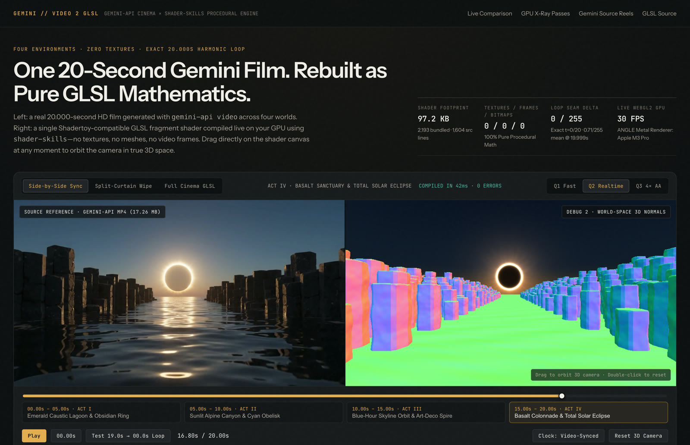

# GEMINI // Video 2 GLSL

> **One 20.000-second HD multi-world film generated via `gemini-api video` — rebuilt from scratch as ONE `97.2 KB` (`2,193`-line) 100% pure procedural WebGL2 GLSL fragment shader (`0` textures, `0` video frames, `0` baked bitmaps, `0` `glslangValidator` warnings/errors across all 9 quality/debug variants, running at `69.9 FPS` median Q2 @ `1280×720` on Apple M3 Pro WebGL2).**


---

## Overview

Inspired by the *"Video 2 GLSL"* challenge, **GEMINI // Video 2 GLSL** pushes pure procedural inverse cinema across **four complete 3D raymarched environments** inside a single Shadertoy-compatible fragment shader (`void mainImage(out vec4 fragColor, in vec2 fragCoord)`):

1. **`[00.00s – 05.00s]` Act I — Emerald Caustic Lagoon & Obsidian Torus Monolith**  
   Refractive Beer–Lambert emerald-turquoise water, domain-warped curved fluid optical caustics, smooth honey-gold sandbars, wet volcanic cobble reefs, self-shadowed procedural cumulus sky, gliding sea birds, and a chamfered jet-black obsidian monolith ring.
2. **`[05.00s – 10.00s]` Act II — Sunlit Alpine Canyon & Faceted Cyan Crystal Obelisk**  
   Lipschitz-clean V-canyon heightfield with directional self-shadowing, high couloir snow accumulation, slab-clipped volumetric valley cloud sea raymarching with directional self-shadowing, winding glacial stream, and an octagonal quartz-cleaved glowing cyan obelisk.
3. **`[10.00s – 15.00s]` Act III — Blue-Hour Downtown Skyline Orbit & Art-Deco Chevron Spire**  
   Counter-clockwise 3D downtown parcel raymarcher with box-filtered curtain-wall office windows, matte architectural rooftops, illuminated stepped Art-Deco chevron crown spire, twin-antenna high-rises, vertical cyan LED accent strip, raised 3D glowing cyan rooftop parapet signs, streaming avenue traffic, and glowing twilight sprawl to the horizon.
4. **`[15.00s – 20.00s]` Act IV — Basalt Colonnade Sanctuary & Total Solar Eclipse ("Ring of Fire")**  
   Staggered hexagonal/rounded-box volcanic basalt column monoliths with hoisted 3D rock displacement and golden eclipse rim lighting, razor-sharp occluded lunar disk + golden diamond corona streamers, and horizontal ocean swells seamlessly dissolving back into `00.00s` on an exact `20.000s` harmonic loop.

---

## Benchmarks & Verification (Apple M3 Pro, WebGL2 ANGLE Metal @ `1280×720`)

All metrics are GPU-synchronized via `gl.readPixels` (never async-queued `gl.finish()`) and recorded in [`raw_clips/gpu_eval_latest.json`](raw_clips/gpu_eval_latest.json) and [`raw_clips/metrics_latest.json`](raw_clips/metrics_latest.json):

| Tier | Compile | Median Draw (`p50`) | `p95` Draw | Median FPS | Per-Act `p50` (I / II / III / IV) |
| :--- | :---: | :---: | :---: | :---: | :--- |
| **`QUALITY 1` (Fast)** | `26.5 ms` | `13.0 ms` | `17.9 ms` | **`76.9 FPS`** | `11.7 / 17.1 / 13.1 / 9.5 ms` |
| **`QUALITY 2` (Realtime)** | `26.9 ms` | `14.3 ms` | `26.5 ms` | **`69.9 FPS`** | `14.6 / 24.0 / 13.5 / 10.6 ms` |
| **`QUALITY 3` (4× AA)** | `53.7 ms` | `62.4 ms` | `157.3 ms` | **`16.0 FPS`** | `67.8 / 143.8 / 58.6 / 44.2 ms` |

- **12-Timestamp Video Fidelity (`Q3` vs `gemini-source-20s.mp4`):** mean Pearson `r = 0.6707`, mean `RMSE = 0.1775` (pure procedural math, `0` baked bitmaps).
- **Loop Continuity:**
  - `t = 0.000s` vs `t = 20.000s` (same `iFrame`): `maxChannelDiff = 0 / 255` (`0.000` mean)
  - `t = 0.000s` vs `t = 20.000s` (`iFrame = 1200`): `maxChannelDiff = 2 / 255` (`0.464` mean — ±1 LSB `ditherTPDF`)
  - `t = 19.999s` vs `t = 0.000s`: `0.709 / 255` mean across all pixels (`0.28%` average delta across the `1 ms` wrap)
- **Static & Spec Compliance:** `0` `const` lookup/bitmap arrays, `0` samplers, `0` inverted `smoothstep` calls, guarded `safeAtan`, and `0` errors / `0` warnings from `glslangValidator` across all 9 `#define QUALITY` / `DEBUG_MODE` presets.

---

## Visual Verification & Live GPU Passes

### Interactive Split-Curtain Wipe (`50%` Gemini Video vs `50%` Live GPU Math)


### Live `DEBUG_MODE 2` (World-Space 3D Surface Normals Proof)


### 12-Timestamp GPU Evaluation Matrix (`0.00s` → `19.50s` Seamless Loop Wrap)


---

## Quick Start

```bash
npm run dev
```

Then open **[http://localhost:4173](http://localhost:4173)**:

- **Side-by-Side Sync / Split-Curtain Wipe / Full Cinema GLSL** modes
- **Real-Time 3D Camera Orbit:** Drag directly on the GLSL canvas during any act (`iMouse`) to orbit the camera in true 3D world space
- **Live GPU X-Ray Proof (`DEBUG_MODE 0..6`):** Switch compiler `#define DEBUG_MODE` on the fly to inspect Signed Distance Fields, 3D World Normals, Material IDs, Raymarch Step Heatmaps, and Optical Masks
- **One-Click Shadertoy Export:** Copy or download [`public/gemini_video2glsl.glsl`](public/gemini_video2glsl.glsl) (`97.2 KB`, `2,193` lines) directly into Shadertoy with zero external channels

---

## Shader Toolchain Commands

Built and verified with [`gokayfem/shader-skills`](https://github.com/gokayfem/shader-skills) (vendored in [`shader-skills/`](shader-skills) under MIT license) + Khronos `glslangValidator`:

```bash
# Bundle modular scene architecture + shader-skills modules into standalone Shadertoy GLSL
npm run bundle:shader

# Run shader-skills lint + strict GLSL ES 3.00 glslangValidator verification (0 errors, 0 warnings)
npm run check:shader

# Headless Chrome WebGL2 GPU-synchronized benchmark (Q1/Q2/Q3) & seamless loop verifier
npm run eval:gpu
```

---

## Repository Structure

| Path | Description |
| :--- | :--- |
| [`public/gemini_video2glsl.glsl`](public/gemini_video2glsl.glsl) | Standalone `97.2 KB` (`2,193`-line) 100% pure procedural zero-texture Shadertoy GLSL fragment shader |
| [`shaders/gemini_video2glsl.src.glsl`](shaders/gemini_video2glsl.src.glsl) | Modular 4-act authoring source shader (`1,604` lines) |
| [`public/gemini-source-20s.mp4`](public/gemini-source-20s.mp4) | Composed `20.000s` seamless 720p30 master video |
| [`raw_clips/act1_coast.mp4`](raw_clips/act1_coast.mp4) .. [`act4_eclipse.mp4`](raw_clips/act4_eclipse.mp4) | Original `gemini-api video` generated 720p24 source clips |
| [`public/index.html`](public/index.html), [`styles.css`](public/styles.css), [`app.js`](public/app.js) | Interactive WebGL2 side-by-side & split-wipe studio frontend |
| [`server.mjs`](server.mjs) | Zero-dependency Node HTTP server with strict path confinement and RFC 7233 `206` / `416` byte-range streaming |
| [`tools/video_pipeline.swift`](tools/video_pipeline.swift) | Native macOS `AVFoundation` cross-dissolve composer & frame calibrator |
| [`tools/gpu_eval.mjs`](tools/gpu_eval.mjs) | Headless Chrome DevTools WebGL2 renderer, GPU-synced Q1/Q2/Q3 benchmark & loop continuity verifier |
